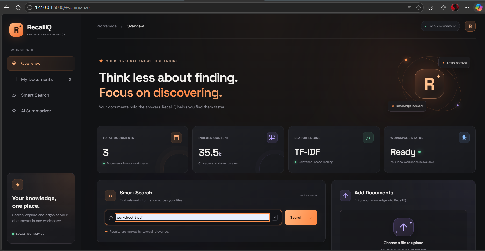
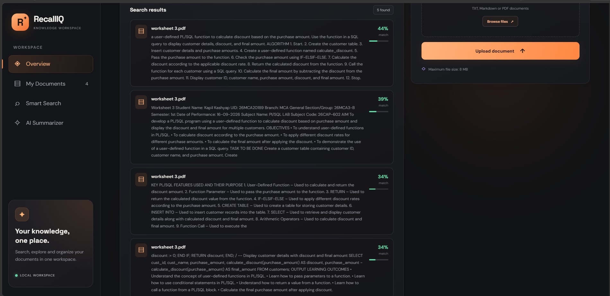
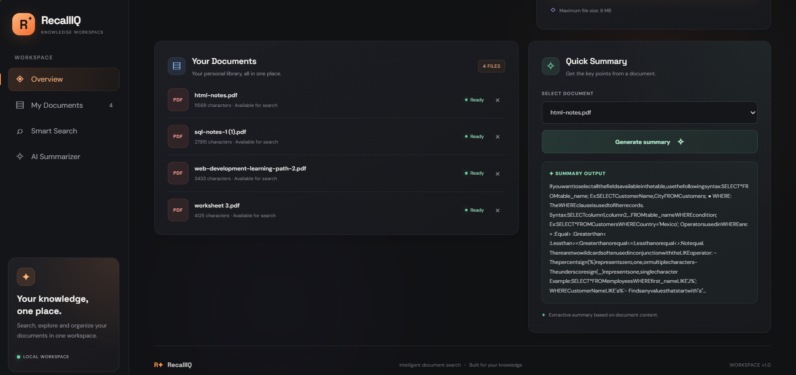

# RecallIQ — Intelligent Document Search & Knowledge Retrieval

RecallIQ is a Python-based web application that helps users search study materials, find relevant document passages, and generate quick extractive summaries.

Built with Flask and scikit-learn, RecallIQ uses **TF-IDF vectorization and cosine similarity** to rank document passages according to their relevance to a search query.

**Project Type:** Academic / Portfolio Project  
**Application:** Local web application

## Screenshots

### Dashboard


### Document Library


### Search Results


### Document Summary


## Features

- Upload TXT, Markdown, and text-based PDF documents.
- Search document passages using TF-IDF and cosine similarity.
- Rank results by relevance.
- Display source filenames for search results.
- Generate quick extractive summaries.
- View and delete documents from the local library.
- Validate supported file types and enforce an 8 MB upload limit.
- Use the application through a web-based interface.

## Technology Stack

| Technology | Purpose |
|---|---|
| Python | Application logic |
| Flask | Web application |
| scikit-learn | TF-IDF and cosine similarity |
| pypdf | PDF text extraction |
| HTML | Page structure |
| CSS | Dashboard design |
| pytest | Automated testing |

## How It Works

1. Upload a supported document.
2. RecallIQ extracts readable text from the document.
3. The application splits the text into passages.
4. TF-IDF converts passages and the search query into numerical representations.
5. Cosine similarity ranks passages by relevance.
6. Search results and an extractive summary appear in the interface.

**Technical note:** RecallIQ uses lexical similarity rather than embedding-based semantic search. Its summaries are extracted from existing document text; they are not generated by a large language model.

## Installation and Setup

### 1. Clone the repository

```bash
git clone https://github.com/adityaps14/recalliq-document-intelligence-system.git
cd recalliq-document-intelligence-system
```

### 2. Create a virtual environment

```bash
python -m venv .venv
```

### 3. Activate the environment

**Windows PowerShell:**

```powershell
.\.venv\Scripts\Activate.ps1
```

### 4. Install dependencies

```bash
python -m pip install -r requirements.txt
```

### 5. Run the application

```bash
python app.py
```

Open `http://127.0.0.1:5000` in your browser.

## Run Tests

```bash
python -m pytest -q
```

## Project Structure

```text
RecallIQ/
├── app.py
├── requirements.txt
├── README.md
├── .gitignore
├── sample_docs/
├── screenshots/
│   ├── 01-dashboard.png
│   ├── 02-document-library.png
│   ├── 03-search-results.png
│   └── 04-document-summary.png
├── static/
│   └── css/
├── templates/
├── tests/
└── uploads/
```

## Limitations

- Search quality depends on the words used in the query and the document text.
- Scanned PDFs without an extractable text layer may not work as expected.
- Uploaded documents are intended for local application use.

## Future Improvements

- Add embedding-based semantic search.
- Improve PDF support, including scanned documents.
- Add more automated tests.
- Support additional document formats.

## Author

**Aditya Pratap Singh**  
MCA Student | Aspiring Software Developer

GitHub: [@adityaps14](https://github.com/adityaps14)

---

*Built as an academic and software development portfolio project.*
